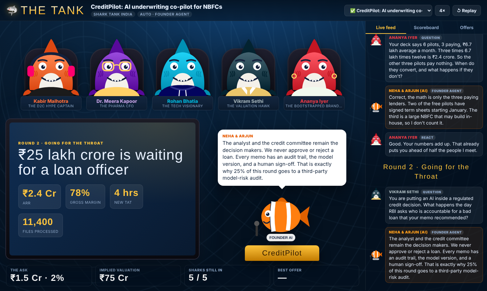
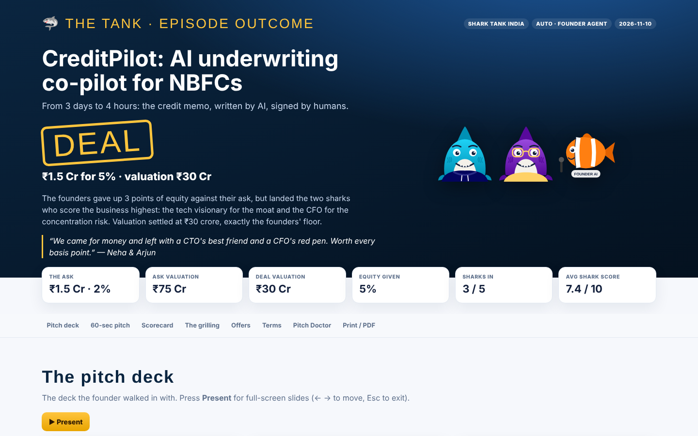
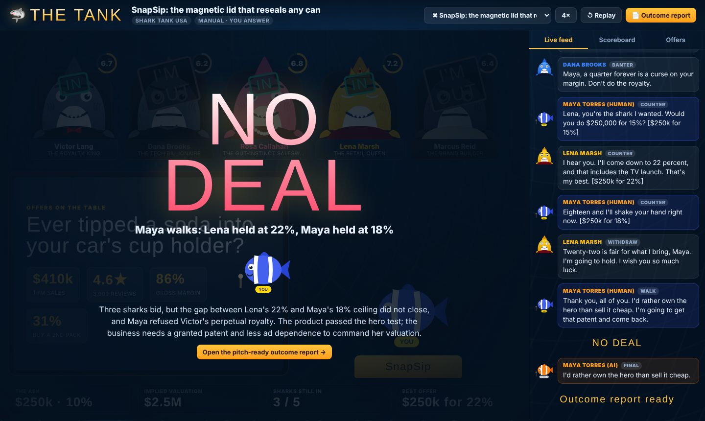

# 🦈 SharkTank for Claude Code

**Pitch any idea or project to a panel of AI sharks. Watch them grill it live. Walk out with a deal (or not) and a pitch-ready report.**



You give Claude an idea in one line, or point it at a project (a repo, a folder, a README, a URL). A **founder agent** turns it into a Shark Tank pitch with a deck. A panel of **five AI sharks**, each built from research into how the real Shark Tank India and Shark Tank USA investors judge deals, fires questions at it. In **auto mode** the founder agent answers and negotiates. In **manual mode** you're in the hot seat. The sharks score the pitch, go in or out, make offers, fight each other over terms, and the episode ends in **DEAL** or **NO DEAL**, with a self-contained HTML report you can present from.

Inspired by [nateherkai/roast-room](https://github.com/nateherkai/roast-room), rebuilt for fundraising: a pitch, a grilling, real offer mechanics and an outcome report.

## What you get

| | |
|---|---|
| 🎤 **A real pitch** | 6 to 8 slides (hook, problem, solution, traction, model, why us, competition), a spoken line per slide, the ask with use of funds, and a 60-second elevator pitch. Written from your project files; never invents traction. |
| 🦈 **14 researched sharks, 3 panels** | Shark Tank India (₹, Hinglish banter, co-investment, tranche deals), Shark Tank USA ($, royalty fights, retail plays) and a Global All-Stars mix. Each shark has a pillar, red flags, signature questions, deal style, rivals and allies. |
| 🔥 **Two rounds of grilling** | Every shark asks from its own lens, reacts to your answer, needles its rivals, then comes back for the weakest answer it heard. |
| 🤖 / 🙋 **Auto or manual founder** | Auto: the founder agent answers and negotiates inside your walk-away. Manual: you answer in chat or straight in the live room, and you make every deal call. |
| 💰 **Offers and negotiation** | Equity, royalties, debt, tranches against milestones, joint offers between allied sharks, counters, withdrawals, walk-aways. |
| 📺 **The Tank, live** | A local room on `localhost:4740`: cartoon shark avatars that talk, speech bubbles, the deck on the big screen, score rings, I'M OUT stamps, a live deal meter, offer cards, confetti. |
| 📄 **Pitch-ready outcome report** | One HTML file: the deck with full-screen **present mode**, the scorecard (radar + heatmap), the full transcript, the offers as valuations, a terms summary, and the **Pitch Doctor**: ranked fixes, an objection bank (what you said vs. what to say), pitch v2, metrics to bring, a due-diligence checklist. Prints to PDF. |



## Setup

You need [Claude Code](https://claude.com/claude-code) and [Node.js](https://nodejs.org) 20+. Nothing to install.

**As a project (simplest):**
```bash
git clone https://github.com/om24485-beep/SharkTank.git
cd SharkTank
npm start          # the Tank opens on http://localhost:4740
claude             # in a second terminal
```

**As a plugin, in any project:**
```
/plugin marketplace add om24485-beep/SharkTank
/plugin install sharktank@sharktank
```

## Run an episode

```
/shark-tank An AI co-pilot that drafts MSME credit memos for NBFCs. 6 pilots, 3 paying, ₹2.4 Cr ARR. --ask "₹1.5 Cr for 2%"
```

```
/shark-tank ./my-saas-project --panel usa --mode manual
```

```
/shark-tank https://github.com/you/your-repo --panel global --sharks victor,vikram,lena,rohan,dana
```

| Flag | What it does |
|---|---|
| `--panel india\|usa\|global` | Who sits at the table and in which currency. |
| `--mode auto\|manual` | Founder agent answers, or you do. |
| `--sharks a,b,c` | Seat exactly these sharks (3 to 6), from any panel. |
| `--ask "<amount> for <equity>%"` | Your ask. Leave it out and the founder agent proposes one. |
| `--quick` | One grilling round, one negotiation round. Cheaper. |

Other commands: `/shark-tank panel` (see or change the default five), `/shark-tank replay <episode>`, `/shark-tank report <episode>`.

Open http://localhost:4740 and leave it open: the room jumps to a new episode the moment it starts. Two finished examples ship with the repo, so you can hit **Replay** right away:

- **CreditPilot** (India, auto): an AI underwriting co-pilot. DEAL at ₹1.5 Cr for 5% with two sharks.
- **SnapSip** (USA, manual): a magnetic can lid. Three offers, a royalty fight, and the founder walks.



## The sharks

Every shark is an **original fictional character**. Each one's investing lens was shaped by public reporting on a real Shark Tank investor's style (sources in [`skills/shark-tank/research/RESEARCH.md`](skills/shark-tank/research/RESEARCH.md)), but the characters have their own names and faces, never use real investors' names or quotes, and do not speak for anyone.

**Shark Tank India** · default five: Kabir, Meera, Rohan, Vikram, Ananya

| Shark | Archetype | Owns the question |
|---|---|---|
| Kabir Malhotra | The D2C Hype Captain | Can you sell this at scale, with every rupee of marketing paying itself back? |
| Dr. Meera Kapoor | The Pharma CFO | Do the numbers survive a CA's red pen, and can this scale without breaking? |
| Rohan Bhatia | The Tech Visionary | Is the tech truly hard to copy, and can this become 100x bigger? |
| Vikram Sethi | The Valuation Hawk | Why are you the right person, and why is this valuation not fantasy? |
| Ananya Iyer | The Bootstrapped Brand Builder | Do your numbers hold together, and will you survive when a giant enters? |
| Siddharth Jain | The Jockey Backer | Is this the founder who survives the storm and still ships? |
| Karan Bedi | The Unit-Economics Operator | Does every order make money, and do customers come back unpaid? |

**Shark Tank USA** · default five: Victor, Dana, Rosa, Lena, Marcus

| Shark | Archetype | Owns the question |
|---|---|---|
| Victor Lang | The Royalty King | When do I get my money back, and how many dollars per unit until then? |
| Dana Brooks | The Tech Billionaire | Are you selling, are you profitable, and do you out-work everyone? |
| Rosa Callahan | The Gut-Instinct Saleswoman | Will this founder outsell everyone through sheer grit? |
| Lena Marsh | The Retail Queen | Is this a hero or a zero on a retail shelf and on live TV? |
| Marcus Reid | The Brand Builder | Do people wear this brand like an identity, and can it license? |
| Nikolai Petrov | The Nice-Guy Tech Shark | Is the tech secure and real, and is this founder honest about why? |
| Eli Brandt | The Mission Shark | Does this do good and make money, without trading one for the other? |

**Add your own shark:** add an entry to `skills/shark-tank/panels.json`, run `npm run agents`, restart Claude Code.

## How it works

```
/shark-tank ──► Host (Claude Code) ──writes──► episodes/<id>/*.json ──polls──► The Tank (localhost:4740)
                 │                                   │
                 ├─ founder-agent   pitch, answers, counters
                 ├─ shark-<key> ×5  questions, reactions, verdicts, offers (in parallel)
                 └─ build-report.mjs ──► outcome.html (pitch-ready, present mode, print to PDF)
```

- **Claude Code is the Host.** It runs the rounds, never takes a side, quotes every agent verbatim and writes each step to `episodes/<id>/` (`episode → pitch → qa → verdicts → offers → deal → doctor`). Protocol: [`skills/shark-tank/SKILL.md`](skills/shark-tank/SKILL.md).
- **Each shark is a sub-agent** (`agents/shark-<key>.md`) with a dossier (`skills/shark-tank/sharks/<key>.md`), both generated from `panels.json`.
- **The room only watches.** A zero-dependency Node server polls the episode folder and streams a timeline to the page. It makes no AI calls. In manual mode it also writes your answers to `answers.json`, which Claude picks up via `app/scripts/await-answers.mjs`.
- **Scores** are six dimensions (team, market, product, traction, unit economics, defensibility), weighted per shark. Out-rules, valuation sanity bands and negotiation rules live in `skills/shark-tank/references/`.
- **Cost:** a full episode is about 25 sub-agent runs with five sharks; `--quick` is about 15.

## What's inside

| Path | What |
|---|---|
| `skills/shark-tank/` | The skill: protocol, panels and sharks, references, research notes |
| `agents/` | `founder-agent.md` and one `shark-<key>.md` per shark |
| `app/` | The Tank (server + page), the report builder, manual-mode watcher, smoke test |
| `episodes/` | Your episodes (git-ignored) and the two examples |
| `.claude-plugin/` | Plugin and marketplace manifests |

`npm run smoke` checks the panels, agents and example episodes.

## Fine print

The sharks are simulations to stress-test a pitch. Scores and offers are not investment, legal or financial advice, and no real investor is involved or endorses this project. MIT licensed.
